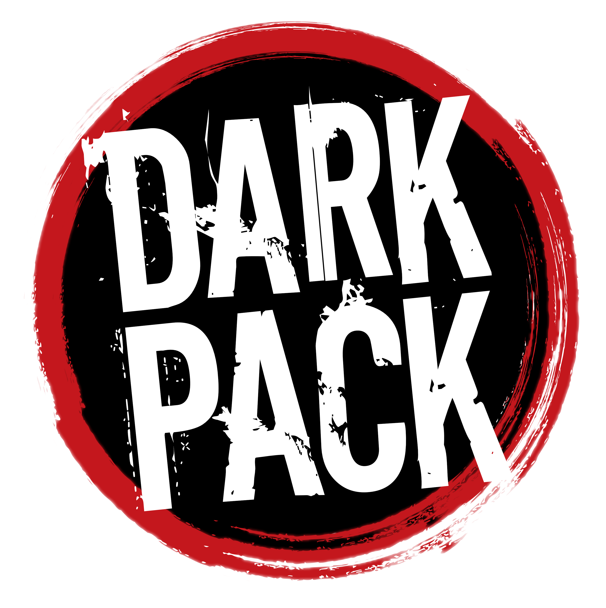

# World of Darkness Expanded (WoDX)

A Foundry VTT system fork and modules for running one World of Darkness chronicle across every game line and every era, 1197 to the far future, on the 20th Anniversary rules.

**Unofficial fan work.** WoDX is not official World of Darkness material and is not made or endorsed by Paradox Interactive AB. Portions of the materials are the copyrights and trademarks of Paradox Interactive AB, and are used with permission. All rights reserved. For more information please visit [worldofdarkness.com](https://www.worldofdarkness.com/). It is free and non-commercial under the [Dark Pack Agreement](https://www.paradoxinteractive.com/games/world-of-darkness/community/dark-pack-agreement), and you need the books to play. See [NOTICE.md](NOTICE.md) for the full notice and third-party credits.

- `system/worldofdarkness/`: the system fork (upstream 7.3.2 by Johan Falt, GPL-3.0).
- `worlds/`: world.json files for the WoDX worlds.
- `docs/`: build log, decisions, module list, phase checklists.
- `tools/`: helper scripts.

Clone this bundle with `git clone wodx.bundle wodx`.
